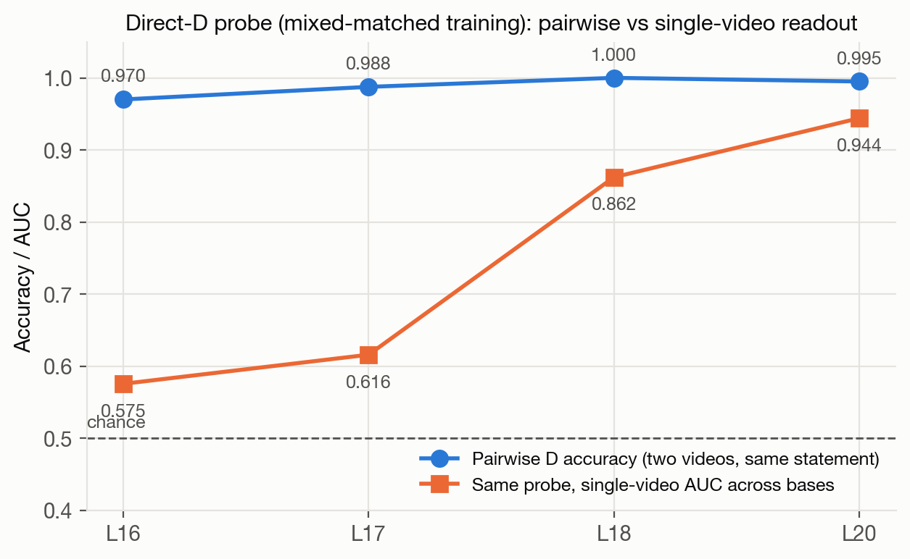
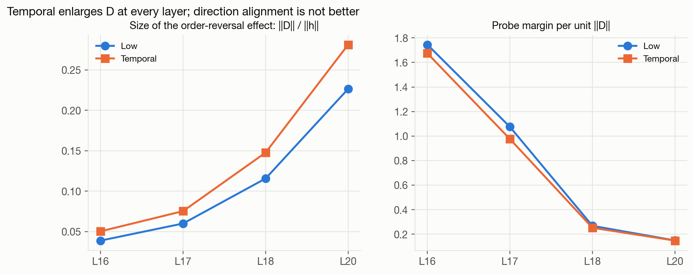
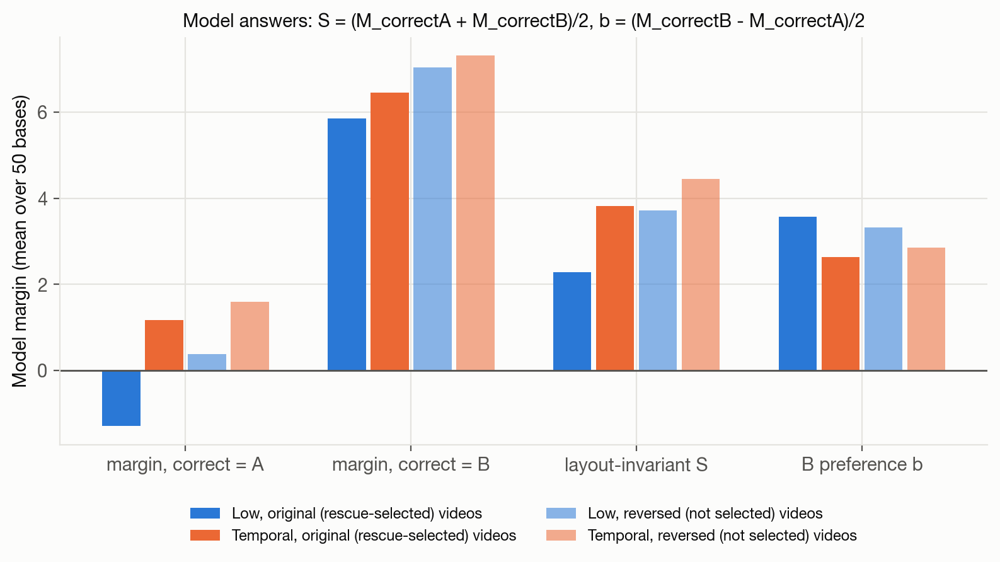
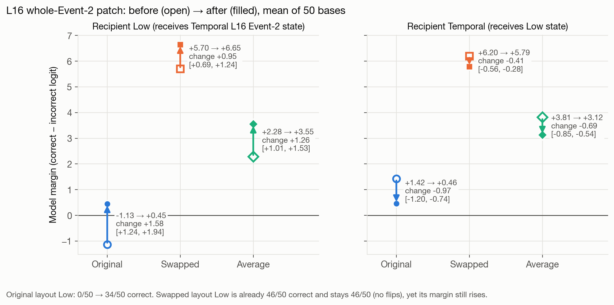
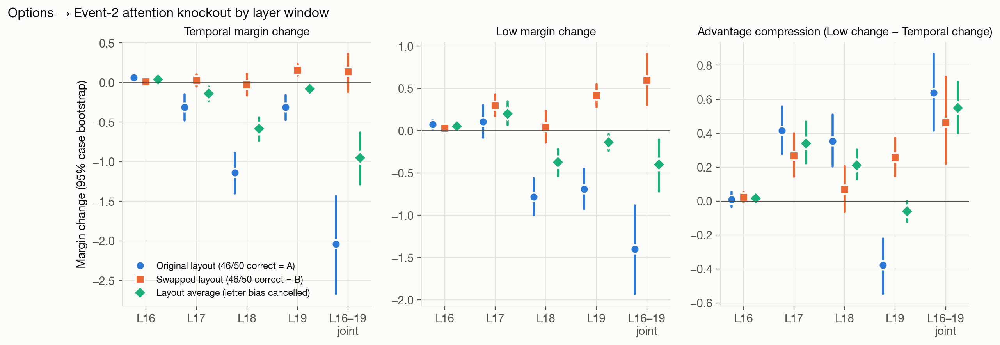
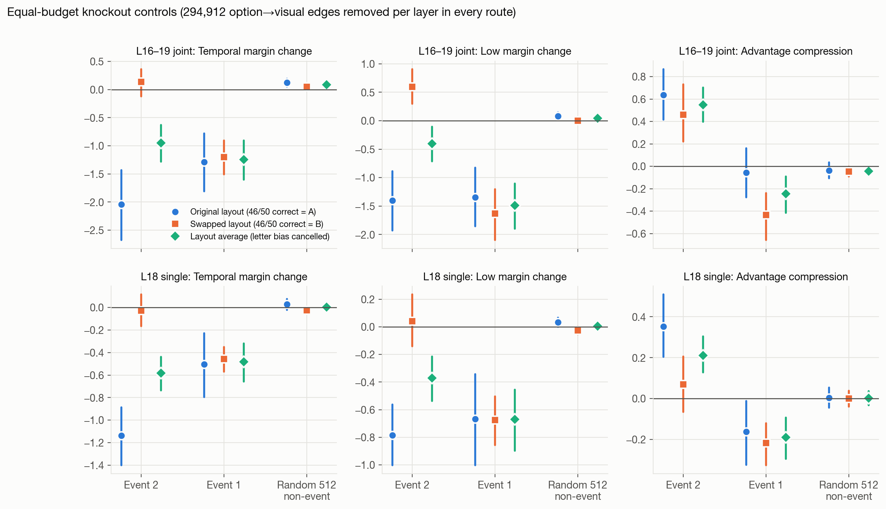
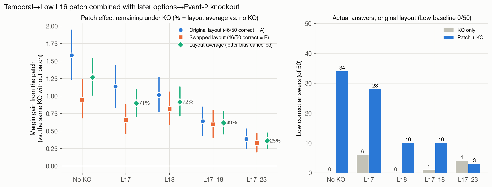
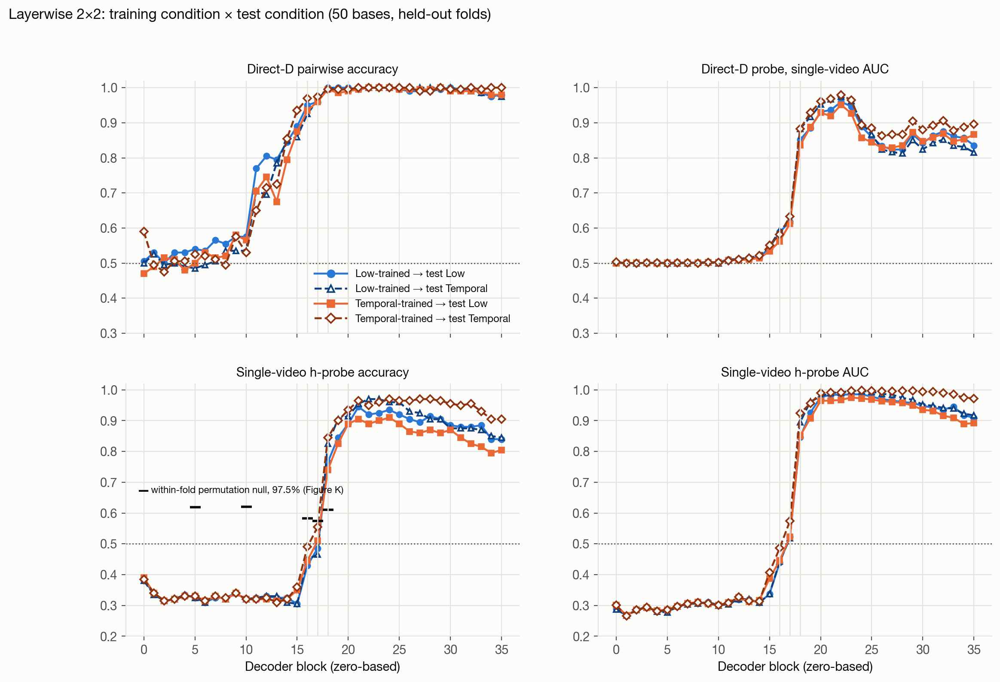
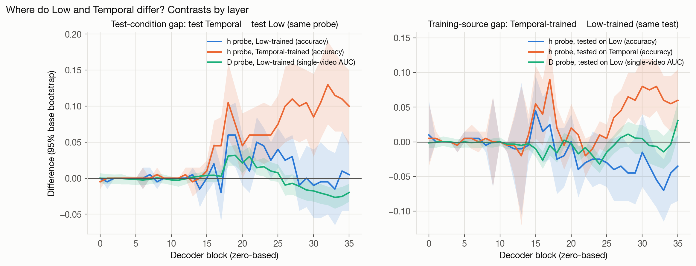
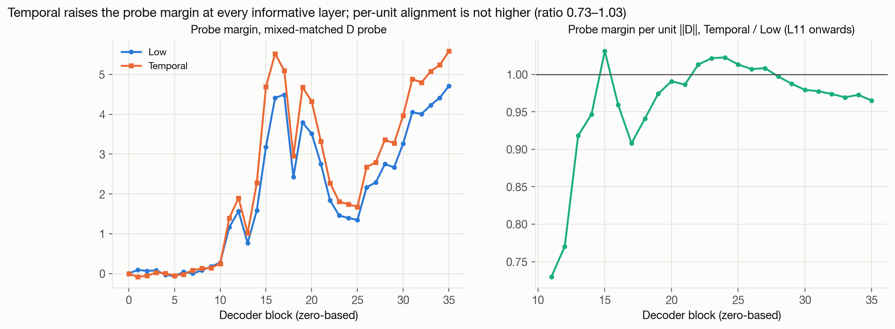

# Experiment Analysis, 2 November 2026: Direct-D Probes, Layout-Symmetric Interventions and All-Layer Probing

Qwen3-VL-8B-Instruct, object-bound before/after matching on the frozen cohort of 50 rescue bases
(original archived prompt: Low wrong, Temporal right). All numbers are means over the 50 bases unless
stated; intervals are 95% case (base) bootstrap intervals. *Model margin* = correct-option minus
incorrect-option first-token logit (> 0 means correct). *Probe margin* = (2y − 1)·z, the probe logit z signed toward the true label y (the functional
margin of the classifier; > 0 means the probe is correct). It is in probe-logit units, comparable only
within one layer and model, and never compared with model margins.

## 0. Summary

1. **Direct-D probe (v3).** Training on same-object, order-reversed video differences
   `D = h(original) − h(reversed)` gives 94–100% held-out pairwise accuracy at L16–L20. The high accuracy
   is **not** an A/B-slot artefact: rows whose label runs against the 92% slot pattern are decoded as well
   (15–16/16 at L16 and L18), and a probe trained only on one layout transfers to the other (90–100%).
   It is high because D is a two-alternative comparison of two videos that differ only in event order.
   Scored on single videos, the same probe falls to AUC 0.575 (L16), 0.616 (L17), 0.862 (L18), 0.944 (L20).
2. **Low and Temporal use the same order direction.** Low-trained and Temporal-trained probes transfer to
   each other. Temporal enlarges the order-reversal effect (‖D‖ about 25% larger at L16–L20; larger probe margin at all 25 informative layers) but does
   not align it better with truth (probe margin per unit ‖D‖ is equal or slightly lower).
3. **The rescue failure is largely a B-letter preference.** With the letter preference cancelled by averaging
   the two A/B layouts, Low is on the correct side in 45/50 bases. The Temporal advantage splits into a
   layout-invariant part (+1.53 [1.28, 1.80]) and a reduced B preference (−0.93 [−1.19, −0.66]); the
   layout-invariant part replicates on unselected order-reversed videos (+0.74 [0.47, 1.01]).
4. **Phase 3F interventions.** The L16 whole-Event-2 patch carries order information in both layouts
   (swapped layout +0.95 [0.69, 1.24]). Event-2 knockout damage was inflated by the letter preference,
   but its compression of the Temporal advantage holds in both layouts (L16–19: +0.55 [0.40, 0.70];
   L17: +0.34 [0.22, 0.47]). Equal-budget random keys do nothing; Event-1 knockout hurts but compresses
   in the opposite direction. Blocking option→Event-2 reads at L17–23 leaves 28% of the patch rescue and
   removes all answer-level rescues (34/50 → 3/50).
5. **Phase 3G all-layer probing (L0–L35).** The order-sensitive difference at the option token appears
   at **L11** (pairwise 0.70–0.77, chance before) and is near ceiling by L16; single-video decodability
   jumps at **L18** (D-probe AUC 0.85–0.88; h-probe accuracy 0.74–0.85) and peaks at L21–L24. A
   test-condition gap (Temporal easier) appears from L16–L18 and, for Temporal-trained probes, persists to
   L35 (+0.10 accuracy). Training-source effects are absent in L18–L24 and emerge only in late layers
   (L26–L35) as a small crossover: Temporal-trained probes are better on Temporal (+0.035 to +0.075) and
   slightly worse on Low (−0.035 to −0.045) than Low-trained probes.

## 1. Runs, Provenance and Verification

| Run | Content | Status |
| --- | --- | --- |
| `rescue50_direct_D_v3` | 200 order-reversed prompt captures (L16/17/18/20) | Complete; raw replay verified; backup verified locally |
| `probes_v2` (CPU) | 80 direct-D outer models, 4 layers × 4 training sources | Complete; independent `--verify_only` replay passed |
| `high_accuracy_audit_v1` (CPU) | label-flip, zero-feature, norm-only, single-layout controls | Complete |
| `vlm_phase3f/run_v1` | 2,000 interventions + 200 gates | Complete; 2,200 rows re-verified; backup (1.4 GB) verified locally |
| `run_v1_verified_analysis_v2` (CPU) | References rebuilt from raw checkpoints | 0 mismatches with frozen references |
| `vlm_phase3g/run_v1` | 400 prompt cells × 36 layers | Data complete and verified (see note); feature store downloaded; VM backup verified but not yet copied off the VM |

**Note on the Phase 3G "FAILED" e-mail.** All four child steps (preflight, capture, export, verify)
completed; the lifecycle then called `export` a second time, which refused because the store already
existed. The status is a bookkeeping error, not a data error: the store was written only after its exact
gate, the VM backup was verified, and an independent local check confirmed the 800 × 36 × 4096 store,
identical endpoint order, and bit-for-bit equality of L16/L17/L18/L20 with the v3 store. `export` is now
idempotent (accepts an identical existing store only); `run_v1` remains bound to its code snapshot.

Gates used in every GPU run: exact replay of frozen full-vocabulary logits, exact processor inputs, a
disabled-hook no-op, and (Phase 3F) bitwise-identical L16 Event-2 states across A/B layouts, which
justifies reusing the archived donor for swapped-layout patches.

## 2. Direct-D Probe (Phase 3E v3)

**Design.** For each base, condition (Low/Temporal), A/B layout and statement, the reference-object
option token is read in the original video and in an order-reversed video with identical objects, paths,
durations, text and token positions. The classifier is trained on `D` with `(D, y)` and `(−D, 1−y)`,
L2 logistic regression without intercept, 5 outer folds by base. y = truth of the statement in the
original-order video.

**Main result (mixed-matched training, archived layout).**

| Layer | Low pair accuracy | Temporal pair accuracy | Low probe margin | Temporal probe margin | T − L probe margin [95%] |
| --- | ---: | ---: | ---: | ---: | ---: |
| L16 | 94% | 99% | 4.569 | 5.659 | +1.090 [0.709, 1.478] |
| L17 | 99% | 100% | 4.458 | 5.178 | +0.720 [0.408, 1.044] |
| L18 | 100% | 100% | 2.422 | 3.003 | +0.581 [0.438, 0.742] |
| L20 | 99% | 100% | 3.449 | 4.312 | +0.862 [0.677, 1.043] |

### 2.1 Why is accuracy so high? Audit

| Control (both layouts, 200 statement pairs per cell) | L16 Low / Temporal | L18 Low / Temporal |
| --- | --- | --- |
| Reference probe | 97.0% / 98.0% | 100% / 100% |
| Labels flipped for random half of bases (mean of 10 seeds, archived) | 46.5% / 46.5% | 43.7% / 44.5% |
| All-zero features | 50% / 50% | 50% / 50% |
| ‖h‖ difference only | 55.5% / 57.5% | 67.0% / 63.0% |
| Trained on archived layout only | 93.5% / 97.0% | 99.5% / 100% |
| Trained on swapped layout only | 90.5% / 92.5% | 99.0% / 99.5% |

**A/B balance.** Training data are balanced by design: each base contributes both layouts, and ±D
augmentation gives every readout slot 50/50 labels. Within a single layout, however, the slot predicts the
label in 92% of canonical rows. If the probe used the slot, the 8% minority rows (the four correct-B
bases) would be near 0% correct. They are not:

| Layer | Training | Test Low: majority / minority | Test Temporal: majority / minority |
| --- | --- | --- | --- |
| L16 | Low-only | 174/184 / 16/16 | 169/184 / 16/16 |
| L16 | Temporal-only | 172/184 / 15/16 | 178/184 / 16/16 |
| L17 | Low-only | — / 14/16 | — / 15/16 |
| L18 | Low-only | 184/184 / 16/16 | 184/184 / 16/16 |
| L18 | Temporal-only | 184/184 / 15/16 | 183/184 / 16/16 |

**Pairwise versus single-video readout (Figure A).** Because the probe is linear without intercept,
`score(D) = w·h_original − w·h_reversed`; pairwise accuracy only asks which of two near-identical
videos ranks higher. Applied to one video at a time, between-base variance dominates the small order
signal (‖D‖/‖h‖ ≈ 0.04 at L16).

| Layer | Pairwise D accuracy | Single-video AUC (same probe) |
| --- | ---: | ---: |
| L16 | 0.970 | 0.575 |
| L17 | 0.988 | 0.616 |
| L18 | 1.000 | 0.862 |
| L20 | 0.995 | 0.944 |

### 2.2 Training source × test condition (4 captured layers)

| Layer | Low-trained → Low / Temporal | Temporal-trained → Low / Temporal |
| --- | --- | --- |
| L16 | 0.950 / 0.925 | 0.935 / 0.970 |
| L17 | 0.960 / 0.965 | 0.960 / 0.975 |
| L18 | 1.000 / 1.000 | 0.995 / 0.995 |
| L20 | 1.000 / 0.995 | 0.990 / 0.995 |

Transfer is near-complete in both directions: the two conditions share one order direction.

### 2.3 Size versus alignment of the order effect (Figure B)

Mixed-matched probe, both layouts pooled (hence slightly different probe-margin values from the
archived-layout main table).

| Layer | ‖D‖ Low → Temporal | ‖D‖/‖h‖ Low → Temporal | Probe margin Low → Temporal | Probe margin per unit ‖D‖ Low → Temporal |
| --- | --- | --- | --- | --- |
| L16 | 2.58 → 3.34 | 0.039 → 0.050 | 4.41 → 5.52 | 1.745 → 1.674 |
| L17 | 4.21 → 5.28 | 0.060 → 0.075 | 4.49 → 5.10 | 1.075 → 0.976 |
| L18 | 9.11 → 11.64 | 0.116 → 0.148 | 2.43 → 2.95 | 0.268 → 0.252 |
| L20 | 22.90 → 28.56 | 0.227 → 0.281 | 3.51 → 4.32 | 0.149 → 0.148 |

‖D‖ is larger under Temporal in 97% of paired statements at L16. The higher Temporal probe margin is a
larger order-dependent change, not a better-aligned one.

## 3. Model Behaviour and the B-Letter Preference

In the original archived layout 92 of 100 rescue prompts have correct answer A; the swapped layout and
the reversed videos invert this. Averaging the two layouts of the same video cancels any constant letter
preference: `S = (M_correct=A + M_correct=B)/2`, `b = (M_correct=B − M_correct=A)/2`.

| Videos | Measure | Low | Temporal | Temporal − Low [95%] |
| --- | --- | ---: | ---: | ---: |
| Original (rescue-selected) | margin when correct = A | −1.288 | +1.170 | +2.458 |
| | margin when correct = B | +5.855 | +6.454 | +0.599 |
| | layout-invariant S | +2.284 | +3.812 | **+1.528 [1.276, 1.795]**, 50/50 bases > 0 |
| | B preference b | +3.571 | +2.642 | **−0.929 [−1.194, −0.657]** |
| | correct answers: correct-A prompt / correct-B prompt (each of 50) | 0/50 / 46/50 | 46/50 / 50/50 | |
| | S > 0 (correct side after cancelling letter bias) | 45/50 | 46/50 | |
| Reversed (not selected) | layout-invariant S | +3.712 | +4.449 | **+0.737 [0.469, 1.008]**, 40/50 bases > 0 |
| | B preference b | +3.325 | +2.856 | −0.469 [−0.703, −0.239] |
| | correct answers, correct = A layout | 28/50 | 34/50 | +6 (+12 pp) |

About 60% of the rescue-cohort Temporal advantage is layout-invariant and about 40% is a reduced B
preference. Low "knows" the order in 45/50 bases; the archived error is mostly the B preference
overriding a weaker correct signal. The unselected reversed videos replicate both parts, smaller as
expected without outcome selection, and match Part 1 (correct-A gain +10.8 pp, correct-B +2.5 pp).

## 4. Phase 3F: Layout-Symmetric Patch and Knockout, Route Controls, Patch × Knockout

Same 50 bases; 2,000 new interventional forwards. Archived-layout Event-2 knockouts and patches are the
frozen Phase 3D results, rebuilt from raw checkpoints. "Average" = per-base mean of the two layouts.

### 4.1 L16 whole-Event-2 patch (Figure D)

| Recipient | Layout | Margin before → after | Change [95%] | Correct answers |
| --- | --- | --- | --- | --- |
| Low ← Temporal | original (46 correct-A) | −1.132 → +0.449 | +1.581 [1.237, 1.938] | 0 → 34 |
| | swapped (46 correct-B) | +5.699 → +6.646 | **+0.947 [0.687, 1.235]** | 46 → 46 |
| | average | +2.284 → +3.547 | +1.264 [1.013, 1.534] | |
| Temporal ← Low | original | +1.423 → +0.458 | −0.966 [−1.198, −0.744] | 50 → 34 |
| | swapped | +6.201 → +5.792 | −0.409 [−0.558, −0.278] | 46 → 46 |
| | average | +3.812 → +3.125 | −0.687 [−0.847, −0.543] | |

The patch raises the correct-answer margin even when the correct answer is B, and the reverse patch
lowers it in both layouts: it transfers order information, not only an A-ward shift. About 0.32 of the
archived +1.58 is letter-dependent.

### 4.2 Options → Event-2 knockout by window (Figure E)

| Window | Temporal: original / swapped / average | Low: original / swapped / average | Compression: original / swapped / average [95%] |
| --- | --- | --- | --- |
| L16 | +0.065 / +0.008 / +0.037 | +0.074 / +0.030 / +0.052 | +0.009 / +0.022 / +0.015 [−0.008, 0.040] |
| L17 | −0.311 / +0.030 / −0.140 | +0.104 / +0.296 / +0.200 | +0.415 / +0.266 / **+0.340 [0.221, 0.467]** |
| L18 | −1.138 / −0.029 / −0.583 | −0.785 / +0.041 / −0.372 | +0.353 / +0.069 / +0.211 [0.128, 0.304] |
| L19 | −0.311 / +0.156 / −0.077 | −0.689 / +0.413 / −0.138 | −0.378 / +0.257 / −0.060 [−0.123, 0.003] |
| L16–19 | −2.039 / +0.136 / −0.951 | −1.401 / +0.597 / −0.402 | +0.638 / +0.461 / **+0.550 [0.398, 0.703]** |

Original-layout endpoints (Temporal): L16–19 +1.423 → −0.616 (30/50 correct → wrong); L18
+1.423 → +0.285 (24/50). Swapped layout: Temporal +6.201 → +6.337 (L16–19) and +6.172 (L18), no flips.
The large archived damage mostly reflects reversion to the B preference once option→Event-2 reads are
blocked; the compression of the Temporal advantage survives in both layouts and is most layout-robust
at L17.

### 4.3 Equal-budget route controls (Figure F)

Each route removes exactly 294,912 option→visual edges per layer (all 32 heads).

| Route | Window | Temporal change (average) | Low change (average) | Compression (average) [95%] |
| --- | --- | ---: | ---: | ---: |
| Event 2 | L16–19 | −0.951 | −0.402 | +0.550 [0.398, 0.703] |
| Event 1 | L16–19 | −1.245 | −1.491 | −0.246 [−0.414, −0.089] |
| Random 512 non-event | L16–19 | +0.085 | +0.043 | −0.042 [−0.089, 0.005] |
| Event 2 | L18 | −0.583 | −0.372 | +0.211 [0.128, 0.304] |
| Event 1 | L18 | −0.482 | −0.671 | −0.189 [−0.295, −0.093] |
| Random 512 non-event | L18 | +0.002 | +0.003 | +0.002 [−0.032, 0.036] |

Event-1 damage is similar in both layouts (L16–19 Temporal −1.289 original, −1.201 swapped) and lowers
original-layout Temporal accuracy to 25/50 (Event 2: 20/50). Random keys leave answers almost unchanged
(Temporal 50 → 48). Event-2 specificity therefore holds for the boundary advantage, not for the size of
the damage: both events are needed to answer, only the Event-2 read carries the Temporal advantage.

### 4.4 L16 patch × later options → Event-2 knockout (Figure G)

Rescue under knockout = M(patch + KO) − M(KO only), Low recipient.

| KO window | Original layout | Swapped layout | Average [95%] | Remaining (average) | Low correct, original: KO only → patch + KO |
| --- | ---: | ---: | ---: | ---: | --- |
| none | +1.581 | +0.947 | +1.264 [1.013, 1.534] | 100% | 0 → 34 |
| L17 | +1.134 | +0.657 | +0.895 [0.706, 1.091] | 71% | 6 → 28 |
| L18 | +1.014 | +0.813 | +0.914 [0.714, 1.129] | 72% | 0 → 10 |
| L17–18 | +0.637 | +0.593 | +0.615 [0.459, 0.781] | 49% | 1 → 10 |
| L17–23 | +0.387 | +0.329 | +0.358 [0.249, 0.470] | 28% | 4 → 3 |

Original-layout endpoints (KO only → patch + KO): L17 −1.027 → +0.107; L18 −1.916 → −0.902;
L17–18 −1.886 → −1.248; L17–23 −2.723 → −2.336. In the swapped layout Low stays 46/50 correct in every
combination. The rescue depends cumulatively on option→Event-2 reads across L17–23, with no single-layer
bottleneck; the residual +0.36 shows a minority route (other positions, or blocks ≥ L24). This
implicates the tested route; it is not a mediation estimate.

## 5. Phase 3G: All-Layer Probing (L0–L35)

**Design.** One normal forward per prompt cell for the same 400 v3 cells; block outputs of all 36
decoder blocks at the two reference tokens. Every cell replayed the frozen full logits exactly, and the
exported 800 × 36 × 4096 store reproduces the v3 L16/L17/L18/L20 vectors bit for bit. For each layer:
direct-D probes (Low-only, Temporal-only, mixed-matched training) and single-video h-probes on the
original-video statements (Low-only, Temporal-only), each tested on held-out Low and Temporal, same folds
as Section 2. Reproduction check: L16, L18 and L20 equal the four-layer results of Section 2 exactly.

**Empirical null for the h-probe.** In L0–L10 the h-probe scores 0.31–0.38 accuracy (AUC ≈ 0.29), below
0.5 in every cell. With exactly balanced labels per base and grouped cross-validation, a probe with no
signal is pushed below chance (the earlier lexical-only control showed the same, 30%). The relevant
baseline for h-probe accuracy is therefore ≈ 0.33, not 0.5. The ±D construction removes this artefact:
D-probes sit at 0.50 in L0–L10.

### 5.1 Layerwise 2 × 2 (selected layers; full table in `layerwise_v1/summary.json`)

| Layer | D pairwise: Low-tr → L / T | Temporal-tr → L / T | D single-video AUC: Low-tr → L / T | h accuracy: Low-tr → L / T | Temporal-tr → L / T |
| --- | --- | --- | --- | --- | --- |
| L0–L10 | 0.47–0.59 | 0.47–0.59 | 0.50 | 0.31–0.38 | 0.31–0.39 |
| L11 | 0.770 / 0.705 | 0.705 / 0.650 | 0.511 / 0.508 | 0.325 / 0.325 | 0.320 / 0.320 |
| L14 | 0.845 / 0.850 | 0.795 / 0.855 | 0.517 / 0.520 | 0.325 / 0.310 | 0.320 / 0.320 |
| L15 | 0.890 / 0.860 | 0.875 / 0.935 | 0.543 / 0.547 | 0.305 / 0.305 | 0.350 / 0.360 |
| L16 | 0.950 / 0.925 | 0.935 / 0.970 | 0.589 / 0.593 | 0.430 / 0.450 | 0.445 / 0.490 |
| L17 | 0.960 / 0.965 | 0.960 / 0.975 | 0.618 / 0.620 | 0.485 / 0.465 | 0.510 / 0.555 |
| L18 | 1.000 / 1.000 | 0.995 / 0.995 | 0.852 / 0.883 | 0.765 / 0.825 | 0.740 / 0.845 |
| L19 | 1.000 / 0.995 | 0.985 / 0.995 | 0.885 / 0.917 | 0.845 / 0.905 | 0.825 / 0.900 |
| L20 | 1.000 / 0.995 | 0.990 / 0.995 | 0.931 / 0.952 | 0.890 / 0.915 | 0.890 / 0.935 |
| L22 | 1.000 / 1.000 | 1.000 / 1.000 | 0.960 / 0.974 | 0.920 / 0.970 | 0.890 / 0.950 |
| L24 | 1.000 / 1.000 | 1.000 / 1.000 | 0.889 / 0.899 | 0.935 / 0.960 | 0.910 / 0.970 |
| L28 | 0.990 / 1.000 | 0.995 / 0.990 | 0.824 / 0.813 | 0.915 / 0.905 | 0.870 / 0.970 |
| L31 | 0.995 / 0.995 | 0.990 / 0.995 | 0.863 / 0.843 | 0.880 / 0.875 | 0.845 / 0.950 |
| L35 | 0.980 / 0.975 | 0.980 / 1.000 | 0.836 / 0.816 | 0.840 / 0.845 | 0.805 / 0.905 |

Three depth regimes:

- **L11–L15, emergence.** Pairwise D rises from chance to 0.85–0.94; single-video readouts are still at
  their null. An order-sensitive change exists at the option token before L16, but it is tiny relative to
  between-base variance.
- **L16–L18, transition.** Single-video decodability starts at L16 (h 0.43–0.49 vs null 0.33) and jumps at
  L18 (h 0.74–0.85; D-probe AUC 0.85–0.88), the block at which option→Event-2 knockout was most damaging in
  the original layout. Peak readability is at L21–L24 (h up to 0.97 accuracy, AUC 0.98–0.997; D-probe
  single-video AUC 0.96–0.98 at L22).
- **L24–L35, late.** Single-video D-probe AUC declines to 0.81–0.90, h-probe stays high (0.80–0.97), and
  condition-specific differences between probes appear (5.2).

### 5.2 Where do Low and Temporal differ? (Figure I)

Test-condition gap = same probe, Temporal test − Low test. Training-source gap = same test,
Temporal-trained − Low-trained. Values with 95% base bootstrap intervals.

| Layer | h, Low-trained: T − L | h, Temporal-trained: T − L | D (Low-trained) single-video AUC: T − L | h on Temporal: Temporal-tr − Low-tr | h on Low: Temporal-tr − Low-tr |
| --- | --- | --- | --- | --- | --- |
| L16 | +0.020 [−0.005, 0.050] | +0.045 [0.020, 0.080] | +0.004 [−0.005, 0.011] | +0.040 [−0.005, 0.090] | +0.015 [−0.030, 0.065] |
| L17 | −0.020 [−0.060, 0.015] | +0.045 [0.005, 0.085] | +0.003 [−0.005, 0.011] | +0.090 [0.040, 0.145] | +0.025 [−0.025, 0.080] |
| L18 | +0.060 [0.025, 0.100] | +0.105 [0.055, 0.160] | +0.031 [0.017, 0.044] | +0.020 [−0.010, 0.050] | −0.025 [−0.075, 0.020] |
| L19 | +0.060 [0.015, 0.105] | +0.075 [0.035, 0.125] | +0.032 [0.018, 0.046] | −0.005 [−0.040, 0.025] | −0.020 [−0.065, 0.020] |
| L22 | +0.050 [0.015, 0.085] | +0.060 [0.025, 0.100] | +0.015 [0.005, 0.025] | −0.020 [−0.050, 0.005] | −0.030 [−0.050, −0.010] |
| L26 | +0.025 [−0.005, 0.055] | +0.100 [0.050, 0.155] | −0.010 [−0.024, 0.004] | +0.035 [0.005, 0.065] | −0.040 [−0.085, 0.005] |
| L28 | −0.010 [−0.045, 0.025] | +0.100 [0.050, 0.155] | −0.011 [−0.027, 0.000] | +0.065 [0.035, 0.100] | −0.045 [−0.085, −0.005] |
| L31 | −0.005 [−0.055, 0.050] | +0.105 [0.055, 0.165] | −0.021 [−0.035, −0.008] | +0.075 [0.035, 0.120] | −0.035 [−0.080, 0.010] |
| L35 | +0.005 [−0.045, 0.050] | +0.100 [0.045, 0.150] | −0.020 [−0.032, −0.007] | +0.060 [0.015, 0.105] | −0.035 [−0.085, 0.010] |

- **Test-condition gap (Temporal easier).** For both probes it appears at L18–L22 (+0.05 to +0.11
  accuracy; D-probe single-video AUC +0.02 to +0.03). For Low-trained probes it then fades; for
  Temporal-trained probes it persists to L35.
- **Training-source gap.** Absent in L18–L24 (the two probes are interchangeable), with an early
  Temporal-specific advantage at L17 (+0.090 [0.040, 0.145]). In L26–L35 a crossover emerges: on Temporal,
  Temporal-trained probes are better (+0.035 to +0.075); on Low they are worse (−0.035 to −0.045; only the
  L28 interval excludes 0, and L22 shows the same sign, −0.030 [−0.050, −0.010]). This is the condition-specific pattern Albert anticipated, but it is
  small and confined to late layers. Direct-D training-source gaps stay within ±0.03 at every layer.

### 5.3 Size versus alignment across depth (Figure J)

The probe margin of the mixed-matched D probe is higher under Temporal at all 25 informative layers
(L11–L35). Probe margin per unit ‖D‖, Temporal / Low, is 0.73–0.95 in L11–L14 and 0.91–1.03 in L15–L35:
never clearly above 1. The all-layer data therefore generalise Section 2.3: Temporal produces a larger
order-dependent change at the option token, not a better-aligned one.

## 6. Integrated Interpretation

The day's results fit a staged **availability → integration → use** account of the temporal-gap
advantage on this cohort:

1. **Availability (L11–L16).** An order-sensitive signal appears at the option reference token from L11,
   in both boundary conditions and with the same direction. Low therefore has the order information
   (also behaviourally: correct side in 45/50 bases once the letter preference is cancelled).
2. **Integration (L16–L22).** The L16 Event-2 visual state is causally relevant: transplanting it moves
   the answer in both A/B layouts, and its effect depends cumulatively on option→Event-2 reads across
   L17–L23 (28% of the rescue left when all are blocked). Over the same depths the order signal becomes
   readable in single videos (sharp rise at L18, peak L21–L24), and Temporal videos become easier to
   read (+0.05 to +0.11). Event-2-specific knockout compresses the Temporal advantage in both layouts,
   most robustly at L17; equal-budget random keys do nothing and Event-1 keys do not compress it.
3. **Use (late layers and answer).** The gap enlarges the order-dependent change without improving its
   alignment, and its behavioural benefit appears where the order signal must overcome the model's
   B-letter preference (correct-A prompts). Late layers carry a small condition-specific component
   (training-source crossover at L26–L35).

What this does not establish: a unique circuit, the operation that computes before/after, mediation, or
generality beyond this model and stimulus family. Gap and absolute timing remain confounded (Section 8).

**Implications for the thesis questions.** SQ3: the gap advantage is real and layout-invariant but
smaller than the rescue-cohort archived contrast suggests (layout-invariant +1.53 on selected and +0.74
on unselected videos), and part of its behavioural size is reduced letter bias. SQ4: the results now
cover representation (where order becomes readable and how it differs by condition), access (route-
specific, equal-budget knockouts) and a joint intervention linking the L16 visual state to later reads.
Reports should quote layout-averaged effects as primary and archived-layout effects as selection-bound.

## 7. Updates to Results Previously Reported to the Supervisor

Earlier summaries sent before the meetings of 5, 14 and 28 October remain correct for the
measurements they describe; today's controls change how some of them should be read.

| Earlier statement (date) | What today's data add | Revised reading |
| --- | --- | --- |
| L18 single-layer KO causes the largest Temporal damage: −1.138, 24/50 correct → wrong (28 Oct) | Swapped layout: −0.029 [−0.165, 0.115], no flips; layout average −0.583 | The L18 damage is mostly a reversion to the B-letter preference. It is not the most robust locus of the boundary effect. |
| L17 gives the largest gap compression, +0.415 (28 Oct) | Swapped layout +0.266; layout average +0.340 [0.221, 0.467] | Confirmed in both layouts; L17 is the most layout-robust compression window among the single layers. |
| L16–19 Event-2 KO: Temporal 50/50 → 20/50 (30 flips), compression +0.638 (KO50, 28 Oct; the 14 Oct KO25 gave 25/25 → 13/25) | Swapped layout: Temporal +0.136, compression +0.461; equal-budget random keys ≈ 0; Event 1 compression −0.246 | Damage size is inflated by the letter preference, but the Event-2-specific compression of the Temporal advantage holds (layout average +0.550 [0.398, 0.703]). |
| "Whole-event KO cuts more connections and has no equal-budget background control" (14 Oct) | Event-1 and random routes with exactly the Event-2 edge budget | Resolved: generic edge removal does nothing; Event 1 matters for answering but does not carry the advantage. |
| Whole-Event-2 L16 patch rescues 34/50, +1.58 (14 Oct) | Swapped layout +0.947 [0.687, 1.235]; reverse patch negative in both layouts | Confirmed as order information; about 0.32 of the archived +1.58 is letter-dependent. |
| Cohort is 46 correct-A / 4 correct-B; findings conditional on this (5 Oct) | Both layouts measured for every intervention and for behaviour | About 60% of the rescue-cohort advantage is layout-invariant and about 40% is a reduced B preference; Low is on the correct side in 45/50 bases once the preference is cancelled. |
| Balanced option probes: L16 50% / 53%, L18 91% / 95% (28 Oct; old T1−T2 contrast) | Direct-D on same-object order reversals: L16 94–99% pairwise; same probe single-video AUC 0.575 | Not contradictory: an order-sensitive signal is present at L16 but small relative to between-base variance; the pairwise signal appears from L11 and single-video decodability rises sharply at L18 (Sections 2 and 5). The earlier contrast-based numbers should not be placed in the same results column. |
| Frozen L16-patch effects on downstream probe scores (L17 +0.279, L18 +0.421, L20 +0.601; 28 Oct) | Not re-run with the direct-D probe | Still based on the earlier T1−T2 probe; treat as historical and do not combine with direct-D numbers. |
| Temporal-relocation control: shifting the Low event sequence later turned one wrong answer correct without any gap (5 Oct) | Not addressed today | Remains open; absolute timing or recency could contribute to the boundary effect (see Limitations). |

## 8. Limitations

- Rescue selection conditions on archived Low wrong / Temporal right; archived-layout contrasts are
  inflated by selection. Layout averages and the unselected reversed videos are the less biased views.
- Gap and absolute event timing are not separated: in an earlier relocation control (5 October), moving the
  Low event sequence later changed one answer from wrong to right without a gap.
- Pairwise D accuracy saturates; single-video metrics and the continuous probe margin are more informative.
- One model, synthetic full-feature Level-5 videos, 50 bases; layers, views and statements are not
  independent cases. Bootstrap intervals are diagnostic and not multiplicity-corrected.
- Knockout blocks option queries to listed keys only; information can reach options through other
  positions. Patch × knockout is descriptive, not a mediation analysis.
- Probe scores from different layers or training sources are not compared in absolute size.

## 9. Files

- Report, figures and figure script: `analysis/reports_20261102/`
- Direct-D: `analysis/phase3e/direct_difference_20261102/` (`probes_v2/`, `high_accuracy_audit_v1/`, `completed_capture_v3/`)
- Phase 3F: `analysis/phase3f/layout_controls_20261102/` (`verified_analysis_v2/`, `vm_backup_v1/`)
- Phase 3G: `analysis/phase3g/alllayer_20261102/` (`feature_store/`, `layerwise_v1/`)
- Code: commits `ca4cc84` (3F), `dc3425f` (3G) on `main`; protocols `docs/phase3f_layout_controls.md`, `docs/phase3g_alllayer_probes.md`.
